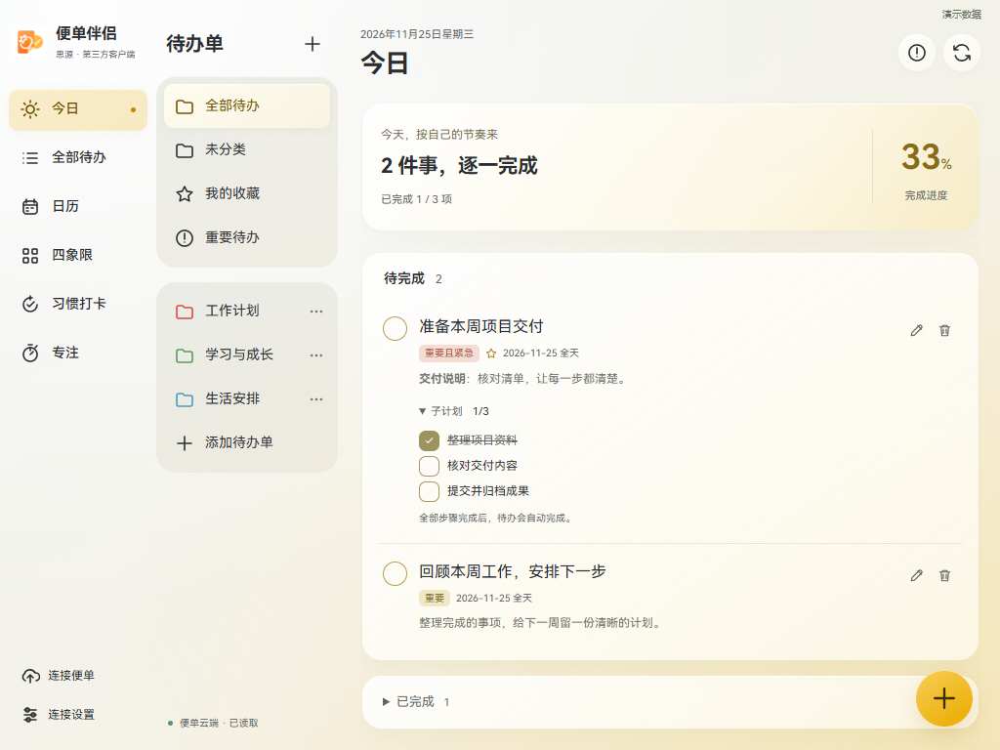

# Biandan Companion · Third-party SiYuan plugin

English | [简体中文](README.zh-CN.md)

Manage your authorized Biandan cloud tasks in SiYuan.
Version **0.5.0-rc.1** aligns with the official Biandan MCP **0.4.6** contract,
adding batched and scoped task deletion plus Biandan 7.1.1 native note styles.
Android, iOS and HarmonyOS SiYuan remain mobile candidates pending real-device acceptance.
The previous stable release is 0.3.3; this version retains its candidate status.
No separate MCP server is required. This is an independent third-party client,
not an official Biandan or Huawei product, and not a native HarmonyOS application.



## Features

- Today, colored task lists, calendar date selection and draggable priority quadrants.
- Create/edit one-off tasks, complete an occurrence, and render Markdown notes,
  including Biandan's native bold, italic, underline, strike, preset colors and indentation.
- Select tasks in All Tasks, preview and confirm deletion of occurrences,
  unfinished occurrences from a date, or whole series. The complete selection
  is processed in groups of 20 without a 20-item total limit; overlapping
  targets from the same task are combined.
- Up to 20 subplans per task. Preview and confirm whole repeating or habit series
  edits while preserving each occurrence's corresponding checked steps.
- Stop further series updates, inspect confirmed results and explicitly resume.
  Interrupted series display unverified progress until reconciliation.
- Choose files, paste/drop images, preview and save to the SiYuan workspace.
- Focus timer with automatic saving at countdown completion, manual saving of paused sessions, and habit occurrence statistics.
- Immediate verified writes, shared page updates, and merged idle cloud reads.

## Install and connect

Search for **Biandan Companion** / **便单伴侣** in SiYuan's desktop marketplace,
install and enable it, then open the top-bar entry and choose Connect.
For local installation, download the selected version's `package.zip` from
[GitHub Releases](https://github.com/ShiShiBits1/siyuan-biandan/releases)
and use SiYuan's local plugin installation.

On desktop, authorize access on the Huawei page opened by the plugin. The temporary OAuth
callback listens only on `127.0.0.1:42681` and closes on completion or timeout.
Do not run another authorization process using that callback simultaneously.

Minimum SiYuan for this candidate: **3.8.11**. Prior native acceptance was performed on **Windows / 3.8.11**.
macOS and Linux desktop backends are declared but have not received real-device
acceptance in this project. Desktop authorization requires system secure storage.
Android, iOS and HarmonyOS SiYuan support is implemented as a candidate and still
requires real-device functional acceptance. The publisher has confirmed additional
authorization to adapt and distribute this plugin for HarmonyOS SiYuan; see the
third-party notices. It runs as web code inside SiYuan, rather than a separate
HarmonyOS native application or HAP. Browser frontends and SiYuan publish pages
are outside this release scope.

### Mobile candidate

Open Biandan Companion from SiYuan's plugin toolbar/menu to use its full-screen
mobile page. Navigation and lists use drawers; editors fit narrow screens and
the on-screen keyboard. Priority quadrants offer an explicit Move action for
touch devices. Native Back/Close protects an open editor or active operation;
save or cancel that operation first.

Each mobile device connects separately. Choose Connect, complete Huawei login
in the system browser, and copy the browser's final local callback address back
into the plugin. The official relay targets `127.0.0.1:42681`; a phone may display
a connection error at that final address. Paste the full address locally into
the authorization form within five minutes. Do not send that address to anyone.
There is no automatic app return or mobile loopback server. Whether the final
address remains accessible in the device's system browser is pending real-device
acceptance; cancel and start again if the browser cannot provide it.

Mobile requests use SiYuan's kernel proxy, with fixed HTTPS destinations and no
redirect following. Refresh credentials and the pending authorization attempt
are encrypted in device-local IndexedDB with a non-extractable WebCrypto key.
They do not use or replace the desktop authorization file and do not sync with
the workspace. This is WebView storage, not a hardware-backed OS keychain.
Missing crypto/storage support stops authorization; there is no plaintext fallback.
Clearing application/site data or changing the WebView origin requires a fresh
connection. Attachment preview/opening uses the native mobile link handler;
file picking and external viewers still need real-device acceptance on each mobile platform.

This revision fixes local package compatibility on HarmonyOS SiYuan. The previous
candidate omitted the `harmony` backend. SiYuan 3.8.12 can display a minimum-version
message for a platform incompatibility, even when its version is already newer.
The minimum stays at 3.8.11; this change does not bypass that requirement.

## Data and limits

Biandan cloud remains the task source; no second SiYuan task database is created.
The plugin uses documented Huawei OAuth/cloud-sync services and Biandan's
renewal service, with no developer-operated task backend. Access tokens stay in
memory. On desktop, refresh credentials are encrypted using system secure storage
before being saved in the local plugin's private state. Mobile uses the separate
device-local encrypted storage and manual callback flow described above.

Choose an **attachment notebook** in settings before uploading. Files are saved
to your SiYuan workspace and indexed by a native document; task notes contain
explicitly labeled SiYuan resource links. Other Biandan clients do not receive
the file bytes and are not guaranteed to open those links. Maximum **5 files per
task**, **20 MiB per file**. Removing links, canceling editing or deleting tasks
does not automatically delete already uploaded source files.

Whole-series editing handles at most **500 existing occurrences**, with no silent
truncation. New subplans start unchecked and may reopen completed historical
occurrences; the preview shows that impact before confirmation. Removing all
subplans preserves each occurrence's overall completion state. Original dates,
reminders, recurrence rules, progress timestamps, notes, native attachment
references and unrecognized fields are preserved.

Updates across cloud records are not atomic. A durable local intent records
confirmed progress; startup never automatically sends pending changes. Explicit
resume checks original versions and full records, skips verified targets, and
stops on later manual changes or changed series membership. Unsupported counting
targets or ambiguous progress are not silently converted. Advanced recurrence
rules, habit scheduling and native reminder delivery remain with the original
Biandan client and its device permissions. The preview contains demo data only.

Deletion always previews its actual scope. A future-unfinished range includes
abandoned occurrences when their completion flag is unset; the preview shows
that count. A date means inclusive local midnight; without a date, the cutoff
is fixed at preview time. An empty range makes no writes. Versions and membership
are rechecked before deletion. Confirmed deletions are retained; uncertain or
partially committed results stop following groups and require a fresh check.
Stop skips subsequent tasks after the current task's deletion and verification
finish. It neither rolls back confirmed work nor interrupts that active group.
Deleting tasks leaves source attachments and focus history intact.

Native note styles are parsed from a fixed tag/color/indent allowlist. Editing
and synchronization retain the original note source, subplans, attachment
references and unknown fields; rendered HTML is never saved back as the note.
The plugin also retains its previous Markdown links and tables, which other
Biandan clients may not render identically.

The SiYuan plugin continues to connect directly to Biandan cloud and does not
depend on a local MCP process. The separate official MCP 0.4.6 service is for
AI clients. Its cloud, renewal and recurrence transports are unchanged from
0.4.3; the new batch-delete tool and note-format guidance do not introduce a
new cloud endpoint.

## Build

With Node.js 20 or newer, run in the source directory:

```sh
npm ci
npm run build
npm run validate:marketplace
```

Output is in `dist/`. The marketplace asset is named `package.zip`, with runtime
files at its root. The public repository includes source, build resources and
validation; maintainer tests, private acceptance workspaces, business records
and credentials are excluded.

## License and attribution

Independently authored code and documentation use [MIT](LICENSE). The supplied
artwork is redistributed under authorization confirmed by the publisher and is
only resized for marketplace requirements. Third-party trademarks and artwork
are not relicensed under MIT. See [third-party notices](THIRD-PARTY-NOTICES.md).

Implemented from the public [Biandan developer documentation](https://gitcode.com/biandangroup/biandan_MCP/tree/main/docs/developers).
The native client and MCP server implementation are not distributed.

[Report issues](https://github.com/ShiShiBits1/siyuan-biandan/issues).

## Automatic focus saving

Countdown completion queues one verified save, including while viewing another page in the plugin. It waits for other writes; a failed or uncertain result remains visible for manual inspection rather than repeated automatic requests. Manual retry uses the same frozen record. Paused sessions can still be saved manually. Timing requires the current plugin page to remain running; closing it, exiting SiYuan or mobile OS suspension does not guarantee background timing or saving.
