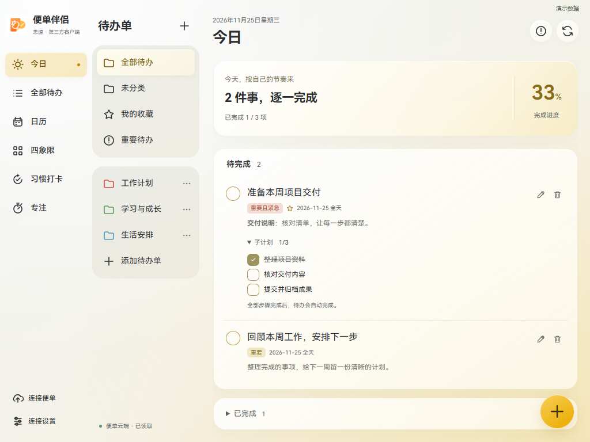

# 便单伴侣 · 思源第三方插件

[English](README.md) | 简体中文



当前候选版本 0.5.0-rc.1，对齐官方便单MCP 0.4.6，新增批量与范围删除、便单7.1.1原生备注样式。Android、iOS及鸿蒙版思源仍保留手机功能待实机验收标识；上一稳定正式版为0.3.3。插件直连便单云端，使用原生JavaScript/CSS，不依赖额外MCP常驻服务。[发行版本](https://github.com/ShiShiBits1/siyuan-biandan/releases) · [问题反馈](https://github.com/ShiShiBits1/siyuan-biandan/issues)。

界面参考官方提供的Windows便单：清单、今日、日历、四象限、习惯与专注，采用柔和光感和琥珀色交互强调。明确为第三方客户端，不是便单官方出品或鸿蒙原生应用。

界面按华为官方沉浸光感资料适配为Web材质：方向环境光、圆角层次、边缘高光和克制的按压反馈，提供深色、窄屏、高对比与减少动效适配，不调用ArkUI原生材质服务。

任务支持文件选择、图片粘贴和拖入，先预览，点击保存才上传。首次请在插件设置中选择“附件保存笔记本”；插件会建立独立的便单附件索引文档，登记资源引用。文件保存到思源assets，备注关联明确标注的思源链接；随已配置的思源工作区同步，便单其他客户端不能保证打开，不冒充便单原生云附件。每条待办最多5个附件，每个20 MiB，支持常用图片、PDF、文本、Office及ZIP。图片可以预览，PDF可在思源打开，其他文件下载原件。移除关联或取消编辑不会删除已经上传的源资源，便单已有原生附件与子任务保留。

操作仍立即保存并核对云结果，已确认结果在当前前端的各工作页共享并局部更新，不再每次保存都重复拉取四张数据表。停止交互约3秒后合并核对云端，空闲时也会定期读取；编辑、拖动、写入或不可见时延期。手动刷新仍可使用。缓存只在当前插件前端内存中，不是延迟写队列；账号切换清空旧快照，未知写结果不自动重放。

桌面端打开顶栏「便单伴侣」后点击连接，在系统浏览器完成华为授权。桌面首次授权使用临时本机回调42681端口，完成或超时关闭；不要同时运行另一个占用该回调的授权流程。令牌只发送到文档指定的服务，桌面刷新凭据须经系统加密后保存，不写入普通日志。无法取得安全存储的环境会明确报错。手机使用下文单独说明的本地加密存储和手动回调流程，不在手机监听端口。

数据以便单云端为准，不生成第二套思源工作台任务。支持一次性任务创建、实例完成/撤销、标题与 Markdown 备注编辑、一次性任务排期调整、带颜色的清单维护、日历选日、四象限拖动、习惯实例统计、专注计时、倒计时结束自动保存及暂停后的手动保存记录。新建入口为右下悬浮加号；全部待办默认筛选未完成，可切换已完成或全部状态。

番茄倒计时结束后自动保存一次，切换到插件其他页面仍生效；遇到其他写入时等待。保存失败或结果未确认会保留本次状态，需手动核查，不连续自动重试；手动重试复用同一条记录，避免重复新增。暂停后的记录仍可手动保存。计时依赖当前插件页面运行，关闭页面、退出思源及手机系统挂起不保证后台计时或保存。

待办支持子计划：新建或编辑时添加、改名、删除步骤，每项最多20步；保存后生效，取消不会改动云端。卡片展开后可直接勾选每步并查看完成数，进度使用便单原生子任务格式。全部步骤完成会自动完成本次待办，撤销一步会重新打开本次待办，并核对父任务汇总。已有步骤删除后保留其余步骤的对应完成状态，新增步骤初始未完成；全部移除时保留此前整项完成状态。原备注、附件和未知字段保留。

重复和习惯待办也可在插件中增删改子计划，修改适用于整个系列。保存前预览现存次数、已完成与已放弃次数，以及将重新打开或变为完成的次数，明确确认后再提交。新增步骤会使原已完成记录重新打开，原有各次勾选按步骤原位置映射，已放弃状态和原最近进度时间保留；日期、重复规则与提醒不会因此改写。后续新生成的执行实例使用修改后的共享结构。预览取消保留草稿，尚未确认前不上传新附件。

系列调整逐条核验并记录本机恢复进度，停止只终止后续处理，不撤回已提交的结果。发生中断时，通过“核查系列调整”查看已确认结果，并显式继续未完成部分；重新打开插件不会自动写云端。核查是只读操作，继续前会检查原记录和版本；已保存目标跳过，其他客户端更改或实例范围改变时停止，避免覆盖。单次最多处理500个现存执行实例，超限整批拒绝，不截断成部分系列。普通计次目标大于1或损坏格式仍不会被静默转换。跨表变更不是原子事务，处理中其他客户端可能短暂看到不同步的结构与进度。

新建任务默认安排在所选日期，全天和待安排分别设置。全天任务会显示在日历；待安排没有指定日期，保留在待办列表，可编辑日期后进入日历。旧版创建的待安排任务不会自动改期。

“今日”列表、统计与新建日期固定使用本机当天日期，仅包含有效执行实例日期范围覆盖今天的事项。过去已结束、未来和未安排日期的待办不会计入今日；跨日任务覆盖今天时会显示。日历选日独立保留，返回“今日”不会沿用日历所选日期。此修复不修改任何云端任务或排期。

删除前会核对并显示范围：一次性任务删除定义和执行记录；重复任务可选择本次、指定日期起未完成的实例，或整个系列。日期起始按本机当天零点包含该日；不指定日期时固定使用预览当时的时间，不在确认期间漂移。“未完成”沿用官方isFinish判断，可能包含已放弃的实例，预览明确显示其数量；未来范围为空时不写入。删除自定义清单会把其中任务移到未分类，默认清单不能删除。附件资产和已有专注历史保留，不做无依据清理。复杂重复规则、习惯排期和地点提醒触发仍由原便单客户端处理；编辑其他字段会保留这些原生属性。原生终端的提醒是否触发取决于该终端权限和设置。

“全部待办”支持批量选择当前筛选结果，切换页面、待办单或状态筛选会清空选择，避免误含隐藏目标。完整选集自动按20组分段处理，没有20条总量限制；同父任务的重复或重叠目标合并。先逐项预览实际影响，再明确确认，写前和删除期间检查版本及实例范围。结果逐项显示已删除、冲突、未执行或待核查；部分或未知结果停止后续处理，不自动重复删除。“停止后续处理”只跳过后续待办，当前待办的删除和核查仍会继续，已确认删除不会回滚。

备注新增便单7.1.1原生富文本子集：固定加粗/斜体/下划线/删除线标签、8种预设颜色、1到4级缩进及严格配对的文本围栏。任意HTML、事件、CSS或危险链接不会执行；编辑和同步保存原始备注源码，不把渲染HTML写回。子任务、附件封装和未知字段保留。插件此前支持的Markdown链接、表格仍可使用，但其他便单客户端不一定呈现相同效果。

本机官方MCP 0.4.6是供AI客户端使用的另一入口，与思源插件版本号不同。此次上游云端、续期和循环传输实现未改变；新增批量删除工具和备注说明，不是新云端服务地址。思源插件仍可独立使用，无需电脑先运行MCP。

云端跨表不是事务：结果不确定或部分提交时保留业务ID并提示先刷新核查，不自动重复创建。数据冲突、网络失败和未授权不会被展示成成功。真实云账号授权、跨端写入与重启续期必须另外验收，模拟测试不能替代。

来源：官方提供biandan_MCP-main.zip内的data-model.md、cloud-access.md及third-party-permission.md；官方链接：https://gitcode.com/biandangroup/biandan_MCP/tree/main/docs/developers 。仅使用公开接口约定，自研实现，不分发原生客户端源码。插件标识使用官方提供的图稿，并保留第三方客户端说明。

0.1.1 候选修复首次创建时误将思源缺文件响应当作损坏日志的问题，保存写入意图后独立回读核实，并统一使用官方提供的图标。
0.2.0 保留上述保护，兼容空成功响应与已知整数列的数字字符串；所有修改仍需写后独立读回确认。原始 HTML 和危险链接不会在备注预览中执行。


## 安装与开始使用

在思源桌面端的集市中搜索“便单伴侣”，安装并启用，点击顶栏图标后选择“连接便单”。也可从本项目 GitHub Releases 选择对应版本，下载 `package.zip`，通过思源本地插件安装入口安装。不要直接覆盖工作空间中的业务数据。

本候选最低思源版本为3.8.11；此前正式版原生验收环境为 Windows / SiYuan 3.8.11，macOS和Linux桌面环境尚未进行本项目真实设备验收。桌面授权仍需系统安全存储。Android、iOS及鸿蒙版思源处于候选适配阶段，手机功能实机验收待完成。用户已确认获得适配鸿蒙版思源并发布本插件的额外授权，见第三方说明；本插件是在思源内运行的网页代码，不是独立鸿蒙原生应用或HAP。浏览器前端和思源发布页面不属于本版支持范围。

### 手机候选版

从思源插件工具栏或菜单打开便单伴侣，进入全屏页面。导航与清单按需展开，编辑页适配窄屏和软键盘；四象限提供“移动”操作，便于触控改象限。原生返回和关闭会保护正在编辑、授权或执行的操作，请先保存或取消当前操作。

每台手机单独连接账号。点击连接，在系统浏览器完成华为授权后，将浏览器最终的完整本机回调地址复制回插件，五分钟内粘贴完成连接。官方中转固定返回 `127.0.0.1:42681`，手机可能显示连接失败，这时需要复制地址栏中的最终地址。请只粘贴到插件内，不发给他人。本版不自动唤回思源，也不在手机开启回调服务；各端浏览器能否保留并复制该地址仍待实机核实，无法取得时取消并重新授权。

手机网络请求通过思源内核代理，只访问固定的HTTPS服务，不跟随重定向。刷新凭据与尚未完成的授权加密保存在当前设备的IndexedDB，密钥为WebCrypto不可导出密钥，不随工作区同步，不读取或覆盖桌面授权文件。这是WebView设备本地存储，不是系统钥匙串或硬件保护；缺少加密或存储能力时停止授权，不降级为明文。清除应用/网站数据或切换WebView来源后需要重新连接。附件沿用思源资源库，通过原生手机链接处理打开；系统文件选择和外部预览仍待各端实机验收。

本版修复鸿蒙版思源的本地包兼容声明：上一候选未列出`harmony`后端，思源3.8.12会把平台不兼容也显示成最低版本提示。最低版本仍为3.8.11，没有通过降低版本要求绕过检查。用户报告的Pura 70 Ultra / 鸿蒙7.0安装提示属于此次排查来源，尚未将修复后的手机真实安装或功能写为已通过。

## 数据与网络

便单云端是待办数据来源。插件只在用户连接账号后使用华为授权和云同步服务，以及便单提供的授权续期服务；不把任务发送到开发者自建服务器。桌面刷新凭据使用系统安全存储加密后写入思源本机插件私有存储，访问令牌只留在内存。桌面首次授权的本机回调仅临时监听 `127.0.0.1:42681`，完成或超时后关闭。手机使用前文的设备本地加密存储与手动粘贴回调流程。请按自己的思源同步与设备权限策略管理工作区。

任务附件存入用户选择的思源工作区，任务备注保存明确标注的资源链接。第三方便单客户端不会因此获得附件文件；跨端打开依赖资源所在的思源工作区。市场预览只含演示数据，不是任何真实账号的截图。

## 构建

使用 Node.js 20 或更新版本，在源码目录执行：

```sh
npm ci
npm run build
npm run validate:marketplace
```

产物在 `dist/`。正式市场发行是根级文件组成的 `package.zip`。公开仓库只包含插件源码、构建资源和校验脚本；维护者本机的测试、验收环境和认证状态不随源码发布。

## 授权与署名

独立创作的源码和文档采用 [MIT](LICENSE)。现有图标按发行者确认的公开再分发授权使用，仅按市场尺寸编码；便单及华为相关商标、图稿等第三方权利不因本项目MIT许可而转移。详见 [第三方说明](THIRD-PARTY-NOTICES.md)。本插件不是便单或华为官方产品，也不代表其背书。
